<div align="center">


# C the Assembly

### A deck-building roguelike in pure C and SDL2

Fight the Assemblers, an invasion of x86 registers, across five real cities. Your deck is made of programming in-jokes, and your buffs come from the **live** local weather.

[](#-under-the-hood)
[](https://www.libsdl.org)
[](#-difficulty-score-and-the-leaderboard)
[](#-check-the-forecast-before-you-fight)
[](#-play-it)
[](https://github.com/Huang-Frederic/C-The-Assembly/raw/d5718881c822a53099e2f289b1cda91b50b8b07b/Installer-C-The-Assembly.exe)

[The story](#-2023-the-world-seems-peaceful) · [Demo](#-see-it-in-action) · [The run](#-one-day-at-a-time) · [The fight](#-five-cards-five-energy-one-register) · [The weather](#-check-the-forecast-before-you-fight) · [The cards](#-a-deck-of-in-jokes) · [The score](#-difficulty-score-and-the-leaderboard) · [The art](#-drawn-for-the-game) · [Under the hood](#-under-the-hood) · [Play it](#-play-it) · [Team](#-team)

</div>

<p align="center">
  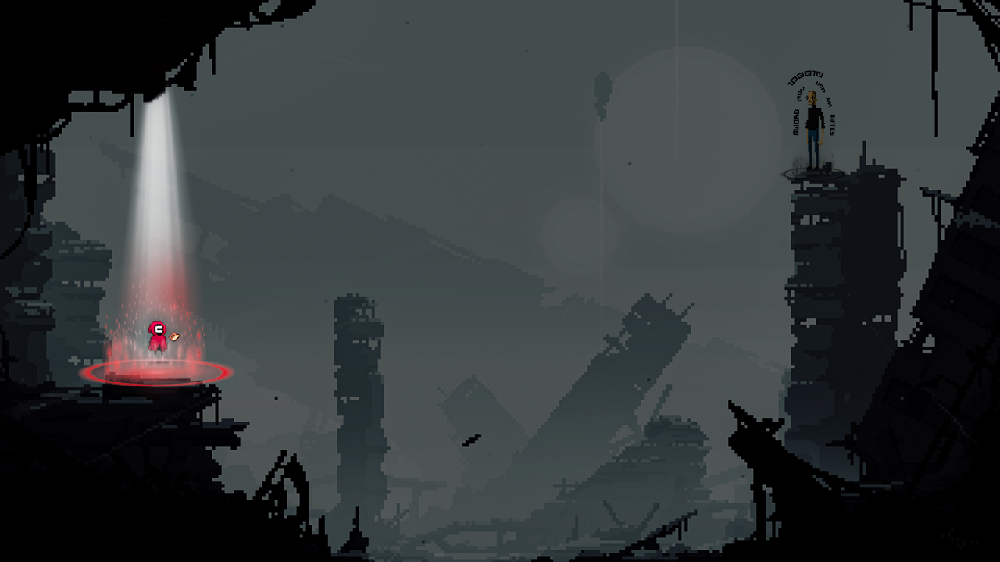
</p>

---

## 🌐 2023. The world seems peaceful…

<p align="center">
  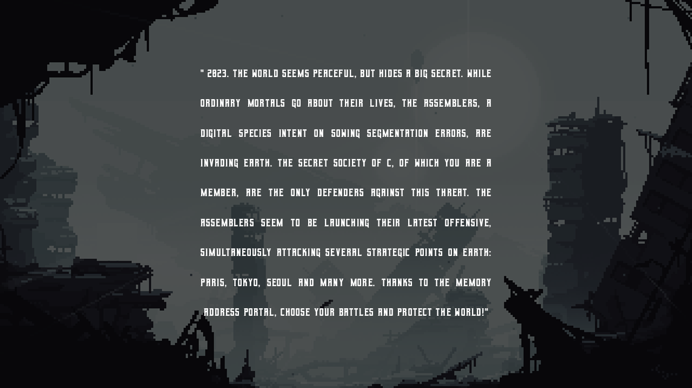
  <br /><sub><em>The intro screen</em></sub>
</p>

**C the Assembly** is a *Slay the Spire*-style roguelike we built for our C programming course. Two students worked on it for seven weeks (December 2023 to January 2024) and wrote about **5,000 lines of C**. There is no game engine: everything is SDL2 surfaces, plain-text data files, a SQLite leaderboard and one HTTP call to a weather API. It shipped as a one-click Windows installer.

---

## 🎬 See it in action

<p align="center">
  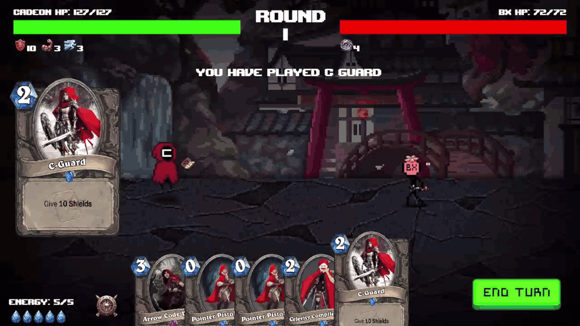
  <br /><sub><em>Shield up, two Pointer Pistol Shots and an Arrow Code Volley, then BX strikes back with Nanobite</em></sub>
</p>

---

## 🗺 One day at a time

A run is an endless series of **days**. Each morning the Memory Address Portal offers **2 or 3 destinations**, and you pick one.

<p align="center">
  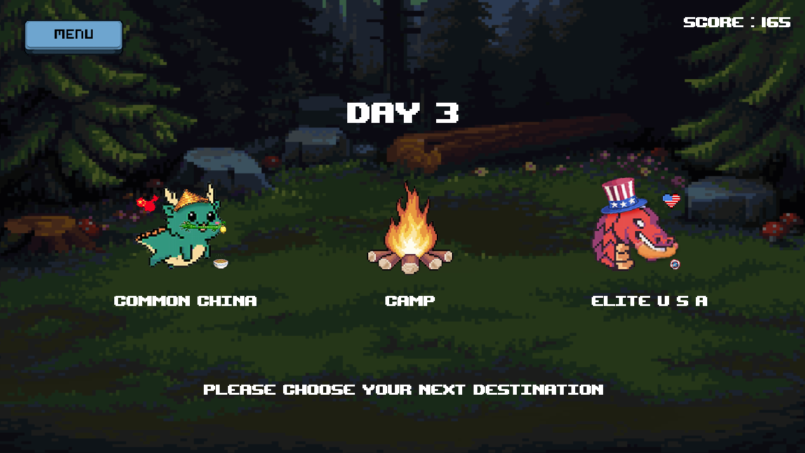
  <br /><sub><em>Day 3: a common fight in China, a camp, or an elite in the USA?</em></sub>
</p>

| Destination | Odds | What happens | Score |
|---|---|---|---|
| **Common** fight | 50 % | A 16-bit register (80 HP) | +100 |
| **Elite** fight | 20 % | A 32-bit register (150 HP) | +300 |
| **Camp** | 20 % | Heals 75 % of max HP | +20 |
| **Treasure** | 10 % | +1 max energy and a random card. Treasures are the *only* way to gain energy | +10 |
| **Boss** | every 10th day | A 64-bit register (300 HP). On boss days it's the only option | +1000 |

Each fight takes place in a random country (**France, USA, China, Korea or Japan**), with its own battlefield and monster. Each day makes the monsters **5 % stronger** and every point you earn **worth 5 % more**. There is no final boss and no ending. The run lasts until you die, and death is permanent: the save file is deleted and your score goes to the leaderboard.

<p align="center">
  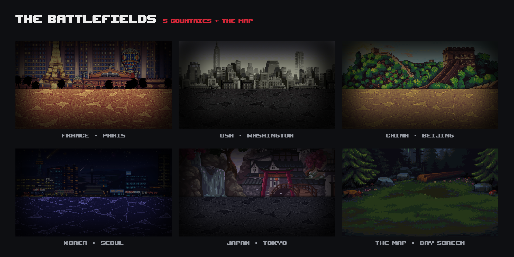
</p>

---

## 💥 Five cards, five energy, one register

At the start of each turn you draw **5 random cards** from your deck and refill your **energy** (5 at the start of a run, up to 28 with treasures). Play what you can afford, then end your turn.

<p align="center">
  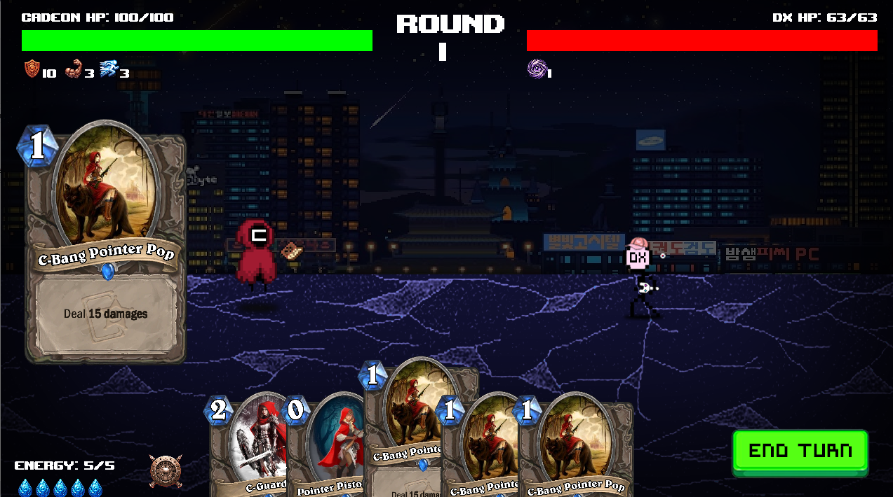
  <br /><sub><em>Round 1 against DX in Seoul: HP bars and active effects at the top, your hand and energy at the bottom</em></sub>
</p>

Cards can deal damage, heal, add armor, or apply **status effects that last 3 turns**. Armor stays for the whole fight and absorbs damage point by point.

<p align="center">
  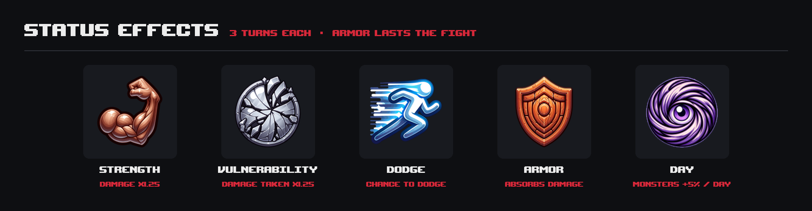
</p>

Monsters have 2 or 3 skills. Their strongest skills run on **cooldowns** read from their data file. Win a fight and you gain **+10 to 20 max HP** and **two new cards** for your deck.

<p align="center">
  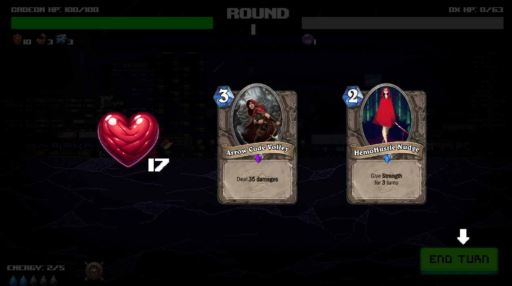
  <br /><sub><em>Victory: +17 max HP, Arrow Code Volley and HemoHustle Nudge join the deck</em></sub>
</p>

The whole fight is animated by hand on raw SDL surfaces: cards slide in and lift on hover with a large preview, attacks use one of three animations (lunge, jump or orbit), screens fade between states, and a chest opens after each victory.

New players get the rules in two illustrated tutorial pages before their first run:

<table width="100%">
  <tr>
    <td width="50%">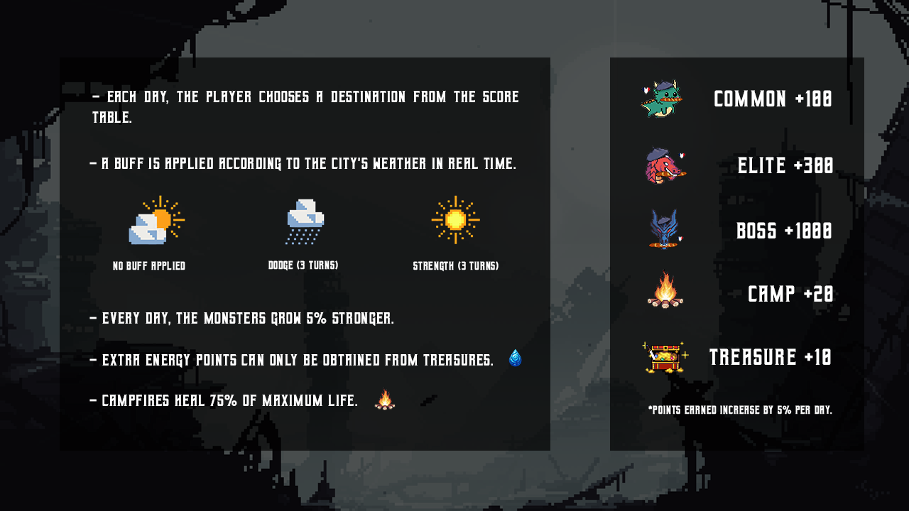</td>
    <td width="50%">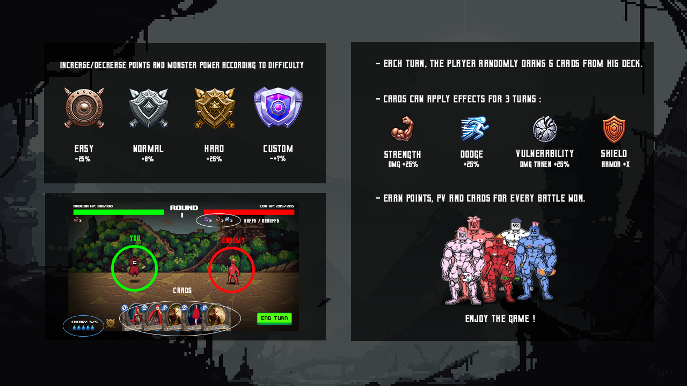</td>
  </tr>
</table>

---

## 🌦 Check the forecast before you fight

This is the mechanic we're proudest of.

When a fight starts, the game uses **libcurl** to call [weatherapi.com](https://www.weatherapi.com) and asks for the *current* weather in the capital of the country you're fighting in (Paris, Washington, Beijing, Seoul or Tokyo). It then parses the reply with **json-c**. The result changes the fight:

<p align="center">
  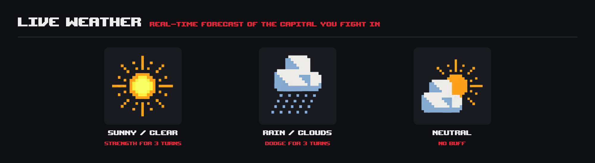
</p>

So the same fight in Tokyo can play differently at 9 a.m. and at 9 p.m.

---

## 🃏 A deck of in-jokes

There are **26 player cards** and **19 monster cards**, each with its own Hearthstone-style card art. The names come straight from a C student's life:

<p align="center">
  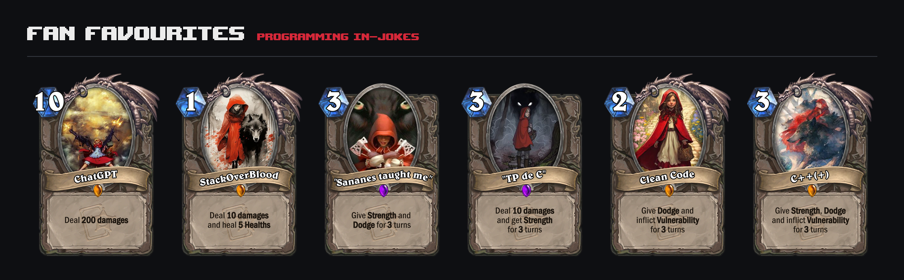
</p>

*ChatGPT* deals 200 damage, but at 10 energy you need five treasures before you can even afford it. *StackOverBlood* is lifesteal, C-style. The monsters answer with *Better Grades*, *Caught Cheat*, *But it's simple*, *It's Low Level* and *Quantum Code*.

<details>
<summary><b>See all 45 cards</b></summary>
<br />
<p align="center">
  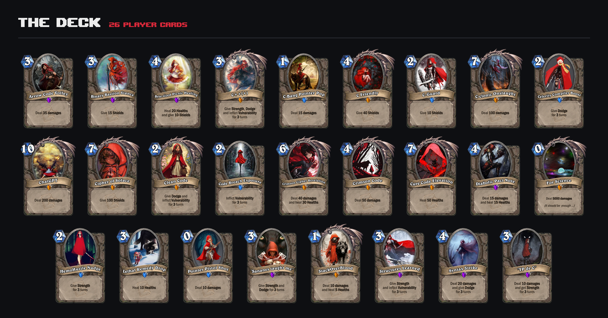
  <br /><br />
  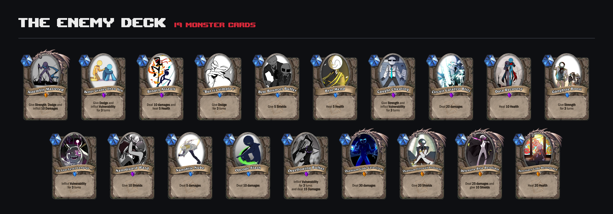
</p>
</details>

### The enemies are registers

Each monster is named after an x86 register, and the register gets wider as the monster gets tougher: 16-bit commons, 32-bit elites and 64-bit bosses.

<p align="center">
  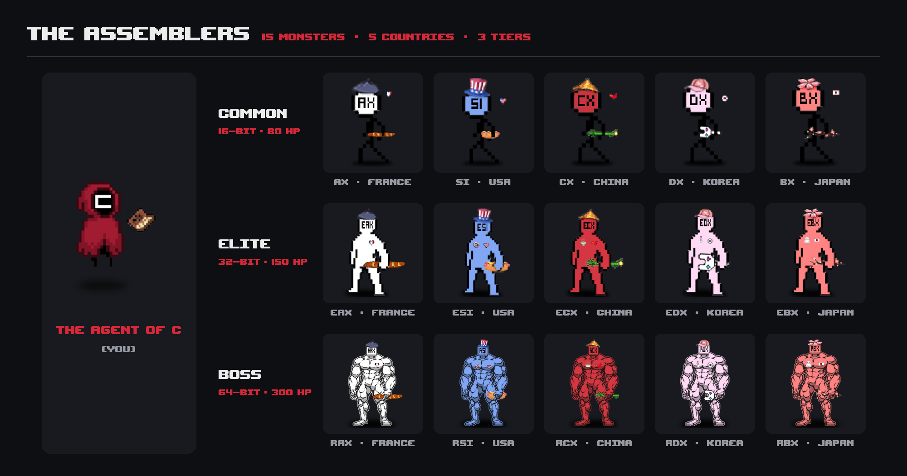
</p>

### Adding content without recompiling

Cards and monsters are **plain-text files with one value per line**. For example, this is `data/cards/__Player__StackOverBlood.txt`:

```text
StackOverBlood   ← name
1                ← energy cost
1                ← animation (1 = lunge, 2 = jump, 3 = orbit)
10               ← damage
0                ← strength
0                ← vulnerability
5                ← heal
0                ← armor
0                ← dodge
```

The reward pool is built at runtime by scanning `data/cards/` with `opendir`/`readdir`. To add a card, drop a `.txt` file and a matching `.png` into the folder and it can drop in the next run, with no recompilation. Monsters work the same way: a name, HP, and up to three skills with their cooldowns.

---

## 🏆 Difficulty, score and the leaderboard

Before a run, you choose your risk:

<p align="center">
  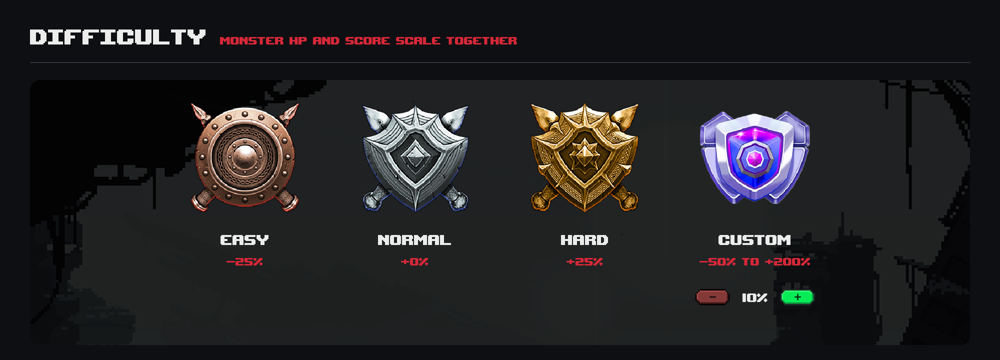
</p>

| Difficulty | Monsters | Score |
|---|---|---|
| **Easy** | −25 % HP; you start each fight with Strength, Dodge and 10 Armor | −25 % |
| **Normal** | — | ±0 % |
| **Hard** | +25 % HP; *they* start with Strength and Dodge | +25 % |
| **Custom** | Any value from **−50 % to +200 %** in steps of 10 | same as the setting |

The custom setting is stored in the **same integer** as the presets: `-1`, `0` and `1` mean Easy, Normal and Hard, and any other value is a percentage. The slider skips 0 and only moves in steps of 10, so the two meanings can never overlap.

When you die, your score goes into a **SQLite** leaderboard (written with prepared statements). The death screen then shows the top 5 and either your rank or how many points you are from the top 5.

The save system is configured in [`c.ini`](c.ini):

```ini
[C]
display_errors = On   ; debug logging to stderr

[SAVE]
auto_save = On        ; Off = checkpoint at game start; you confirm each save,
                      ;       and unsaved progress is rolled back when you quit
```

---

## 🎨 Drawn for the game

The team made the game's visuals for the game: the monsters, battlefields, map nodes, icons, buttons, menus and tutorial screens. The cards are built on a Hearthstone-style frame. In total, the game loads **122 images**, all stored as plain PNGs in [`data/`](data/).

<p align="center">
  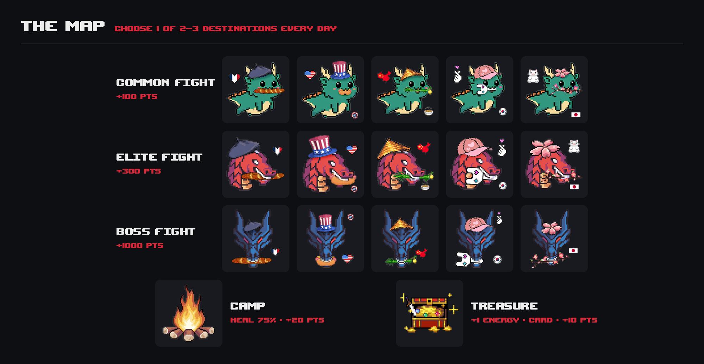
  <br /><br />
  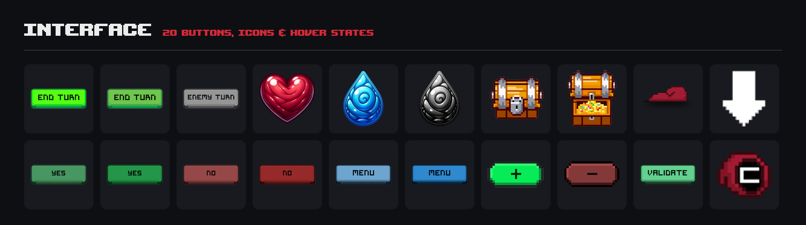
</p>

<details>
<summary><b>See every asset on one board</b></summary>
<br />
<p align="center">
  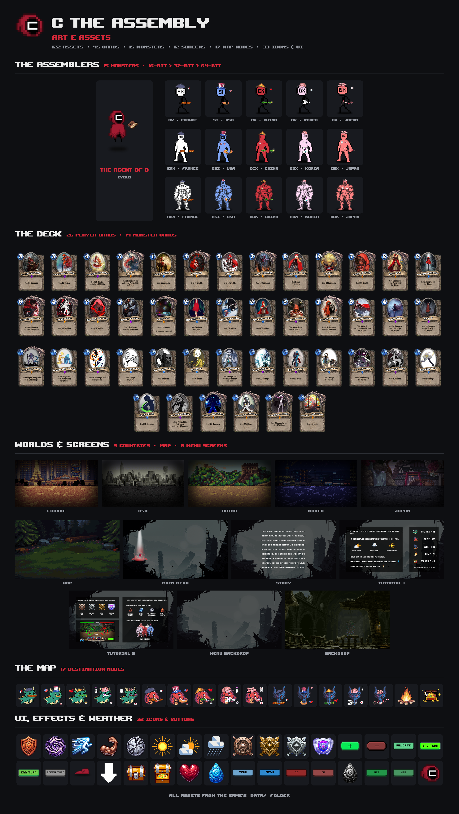
</p>
</details>

---

## 🛠 Under the hood

| Layer | Choice | Why |
|---|---|---|
| **Language** | C, compiled with GCC (MinGW-w64) | It was the course requirement. |
| **Rendering** | SDL2 2.28 + SDL2_image + SDL2_ttf | A window, surfaces and a font. We built everything else ourselves. |
| **Network** | libcurl + json-c | One HTTP GET per fight to weatherapi.com, then JSON parsing. |
| **Persistence** | SQLite3 for the leaderboard, plain text for everything else | Cards, monsters and saves stay human-editable. Only the ranking needs queries. |
| **Config** | `c.ini`, parsed by hand | Debug-log toggle and auto-save mode. |
| **Packaging** | `windres` icon resource + Inno Setup installer | A real `.exe` with an icon, installable in one click. |

The code is split into one module per concern:

| Module | Lines | Responsibility |
|---|---|---|
| [`features/combat.c`](features/combat.c) | 2,011 | Turn loop, card resolution, monster AI and cooldowns, status effects, animations, rewards, win and death screens |
| [`features/menu.c`](features/menu.c) | 852 | Main menu, story, new game, difficulty and custom-difficulty screens |
| [`features/map.c`](features/map.c) | 525 | Daily destination generation and the map screen |
| [`features/event.c`](features/event.c) | 391 | Camp, treasure, saving |
| [`features/default.c`](features/default.c) | 342 | SDL init and shutdown, asset loading, fades, `c.ini` parsing |
| [`features/database.c`](features/database.c) | 307 | SQLite CRUD for the leaderboard |
| [`features/weather.c`](features/weather.c) | 175 | libcurl client and weather classification |
| [`features/input.c`](features/input.c) | 84 | Username entry |

A few design choices worth mentioning:

- **Single translation unit.** `main.c` includes every module directly, a "unity build". It's simple to compile, but it is also why globals can be defined in headers (see tech debt).
- **One event loop per screen.** Each screen polls its own SDL events and calls the next screen when it's done. `main()` is just `init(); while (1) display_menu();`.
- **Content is data.** Cards, monsters and saves are text files read with `fscanf`. Only the leaderboard uses SQL.

---

## 🚀 Play it

### The easy way: the installer (Windows)

**[⬇ Download `Installer-C-The-Assembly.exe`](https://github.com/Huang-Frederic/C-The-Assembly/raw/d5718881c822a53099e2f289b1cda91b50b8b07b/Installer-C-The-Assembly.exe)** (Inno Setup, about 80 MB). It bundles the game and every runtime DLL it needs. An internet connection is needed for the weather.

### From source (Windows + MinGW-w64)

The SDL2 headers, import libraries and DLLs are already in the repo (`src/`, root folder). You also need **sqlite3**, **libcurl** and **json-c** from your toolchain. With [MSYS2](https://www.msys2.org) (MINGW64 shell):

```bash
pacman -S mingw-w64-x86_64-gcc mingw-w64-x86_64-sqlite3 mingw-w64-x86_64-curl mingw-w64-x86_64-json-c make
```

```bash
make          # gcc … -lSDL2main -lSDL2 -lSDL2_image -lSDL2_ttf -lsqlite3 -lcurl -ljson-c
```

```bash
./main        # run from the repo root: all asset paths are relative
```

The weather call needs a [weatherapi.com](https://www.weatherapi.com) key, which is set in [`features/weather.c`](features/weather.c).

---

## 🧾 Honest tech debt

This was our first sizeable C program, and some of the code shows it. Here's what I'd fix with another two weeks:

- **Memory and resource leaks in the render loop.** Some icons (mana orbs, status icons, buttons) are reloaded from disk every frame and never freed, and fonts are reopened on every text render. This is almost certainly the cause of the "random freeze" our commit history complains about. The fix is a texture and font cache loaded once at startup.
- **Two rendering paths.** Menus use `SDL_Renderer`, while the map and combat screens blit to the window surface. SDL doesn't support mixing the two on one window. Everything should move to `SDL_Renderer`.
- **Busy-wait loops.** Some "wait for click" loops poll without a delay and keep one CPU core at 100 %.
- **Unity build with globals in headers.** It works only because there's a single translation unit. Proper `.c`/`.h` separation and `extern` declarations would fix it.
- **Windows-only.** The build links `mingw32`, uses a backslash include and GCC case ranges, and some asset paths rely on Windows' case-insensitive file system.
- **Repository hygiene.** Binaries (`main.exe`, DLLs, `.o`, two installer versions) were committed, which makes the `.git` folder about 260 MB. There's no `-Wall`, no tests and no CI.
- **Gameplay gaps.** There's no draw or discard pile, you can't choose your card rewards, monsters don't telegraph their next move, the tutorial overstates the Dodge chance compared to the code, and the debug card *For Science* (0 energy, 5,000 damage) can still drop on `main`.

---

## 👥 Team

| | Contributor | Main contributions |
|---|---|---|
|  | **Frédéric Huang** · [@Huang-Frederic](https://github.com/Huang-Frederic) | Combat system (turn loop, effects, monster AI, animations), daily map, camp and treasure events, save system and `c.ini` config, win and death flows, leaderboard screens, weather integration in combat, release build |
|  | **Franck Zhuang** · [@franckzhuang](https://github.com/franckzhuang) | Initial SDL setup, SQLite leaderboard layer, weatherapi.com client, main menu and custom difficulty, card and monster file parsing, Makefile, Inno Setup installer |

91 commits, organized with git-flow (`develop`, plus `feature/*` and `bug/*` branches).

---

## 📄 License

This is an academic project. The source code is shared for portfolio and learning purposes only. The card frames follow the style of *Hearthstone*, and all third-party artwork belongs to its respective owners. No license is granted for commercial use or redistribution.

---

<div align="center">

Built in seven weeks by two students, with more segmentation faults than we'd like to admit.

</div>
